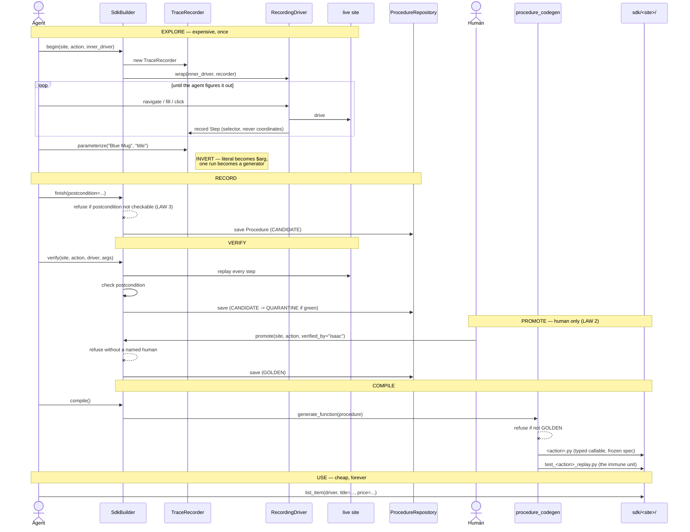
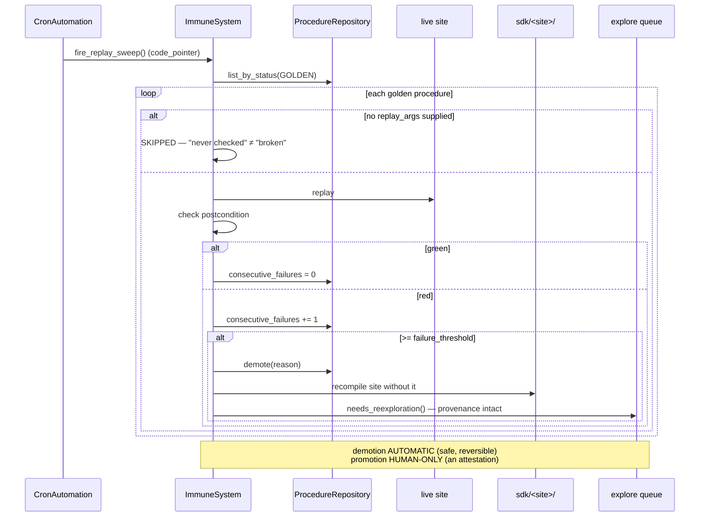

# 22 — SEQ: the procedure→SDK pipeline (and its rehydration protocol)

REHYDRATION (read these, in this order, before working this feature):[
1. `base/sdna/sdna/selfbot_extensions/DESIGN.md` — the whole design; §3 (the three laws) is load-bearing
2. `base/sdna/sdna/selfbot_extensions/domain/procedure.py` — the domain object; the laws are enforced here
3. `base/sdna/sdna/selfbot_extensions/domain/procedure_codegen.py` — the compile step
4. `base/sdna/sdna/selfbot_extensions/application/sdk_builder.py` — the pipeline surface
5. `base/sdna/sdna/selfbot_extensions/application/immune.py` — the sweep that prevents silent rot
6. `base/sdna/tests/test_selfbot_extensions_pipeline.py` — every law has a test; read them as the spec
7. `base/sdna/sdna/selfbot_extensions/.claude/rules/selfbot_extensions_states.md` — what is open
]
NOT:[read the whole train doc for this feature — this list is the scoped set]

## The pipeline

## The immune loop (what keeps it true)

TRIGGER:[working on the procedure/SDK layer · adding a site · a golden procedure
demoted and needs re-exploration · changing the codegen templates · about to
add a browser adapter behind `PageDriver`]
