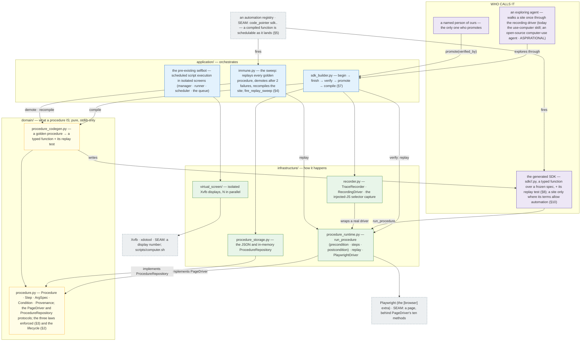

# selfbot_extensions — the stack

<docsys kind="arch-map" role="instance"/>

Drawn from `../../DESIGN.md` (§2–§9). Onion: the domain says WHAT, the infrastructure says HOW, the application
orchestrates; arrows are dependency direction (who calls whom); every external dependency ends at its seam.

## THE DEV FLOWS PLACED ON IT

| dev flow | where it runs on the map |
|---|---|
| `base/sdna/.claude/rules/22-seq-procedure-sdk-pipeline.md` — EXPLORE → RECORD → VERIFY → PROMOTE → COMPILE → USE, and the immune loop | `AGENT → BUILDER → REC`, `BUILDER → STORE`, `BUILDER → RUN`, `HUMAN → BUILDER`, `BUILDER → GEN → SDK`, `SDK → RUN`; the loop: `REG → IMMUNE → RUN`, `IMMUNE → GEN` |
